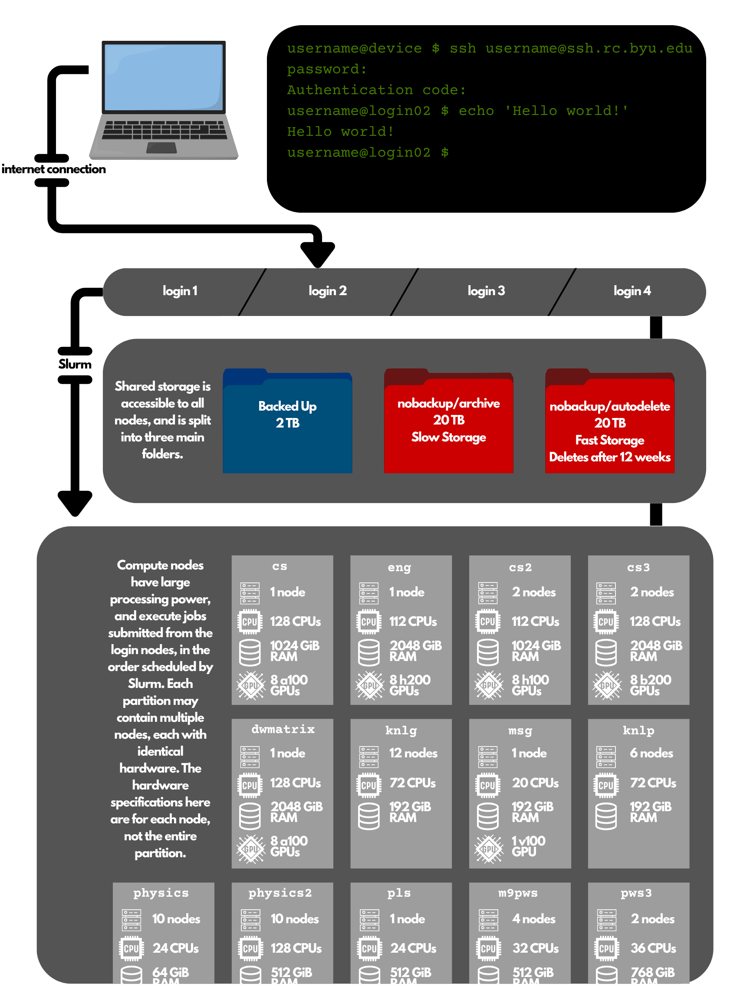
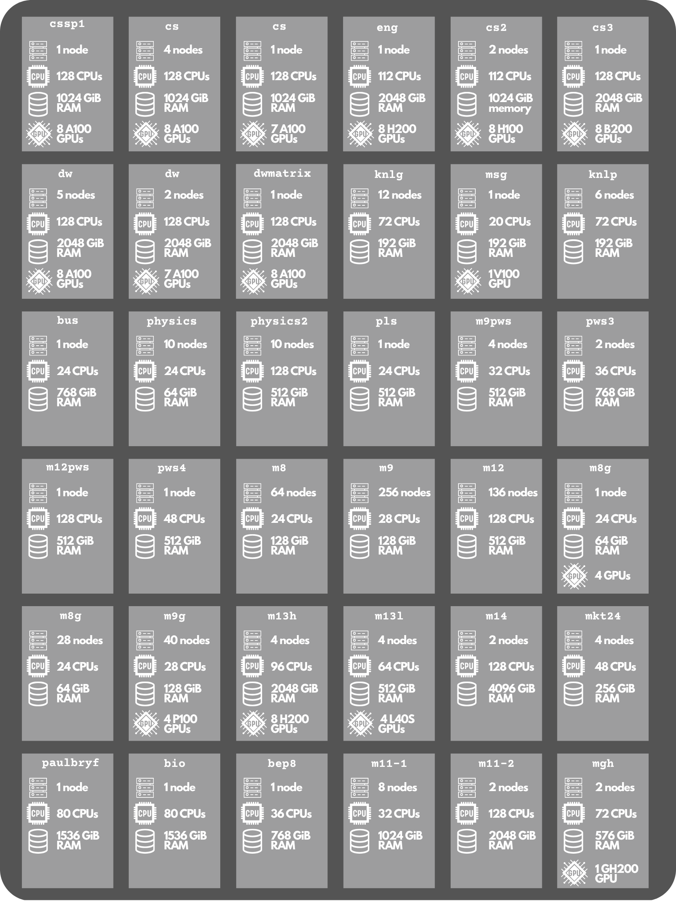

The BYU Supercomputer is an oft misunderstood and underutilized resource. This guide aims to instruct a new user about its different parts and how they may be useful.

## Background: Computer Architecture

Basic knowledge about the components of a modern computer is useful to understanding the BYU supercomputer. A computer has three fundamental hardware components. Firstly, processors (CPU or GPU) execute instructions. CPUs (Central Processing Units) are optimized for following logical, sequential operations. GPUs (Graphic Processing Units) are optimized for large, parallelizable tasks. Secondly, memory stores files, such as text or images, as well as instructions and data, both computed and intermediate. Memory hardware comes in two forms. Persistent memory or disk space is long term, and slower to fetch from. Disk space usually stores a user's files. Random Access Memory, or RAM, is short term, and designed to trade information with the processor rapidly, storing intermediate outputs for brief moments before the processor requests it back again. Lastly, input/output, or I/O, devices such as a keyboard and a screen, respectively, allow a user to interface with the hardware. A keyboard, for instance, is used to provide instructions for the processor to execute, or to download files into persistent memory. A screen lets the user see what they are doing and prints outputs. An operating system, though software, not hardware, manages hardware resources and applications running on the hardware. It also greatly simplifies how the user interfaces with hardware by translating human-readable instructions into more obscure machine language. In the context of computing, a computer is more often called a *machine*.<a href="#ref1" class="cite-ref">&#8201;[1]</a>

## Connecting to the cluster

The BYU supercomputer (or the cluster) is best understood as a connected collection, or network, of machines, along with an interface for using these machines remotely. The user has a local machine, perhaps a laptop or desktop with an internet connection. Their I/O devices (the keyboard and screen of the local machine) connect to the operating system and hardware of the supercomputer's machines via the internet. Through a terminal window on the user's local computer, the user can execute instructions or manage files on machines with access to ~40 terabytes of persistent memory, and up to 128 CPU cores, 4096 GiB of RAM, and 8 NVIDIA GPUs, all through an internet connection. The same internet connection allows the user to move files from their local machine to the virtual machine or vice versa.<a href="#ref2" class="cite-ref">&#8201;[2]</a> The BYU supercomputer uses the Linux operating system, which is the standard choice for servers.

The connection between local and virtual machine is encrypted using a secure algorithm called SSH, and is further protected via two-factor authorization.<a href="#ref3" class="cite-ref">&#8201;[3]</a>

Each machine in the cluster (each of which has processors and memory) is called a node. The cluster has four login nodes, which are the only nodes to which users can connect their local machine's I/O devices (screen and keyboard). These login nodes mediate between the user and the rest of the cluster's resources. The user connects to the login nodes, so when they enter commands on their device, those commands are sent to the login nodes, and the results of those commands are sent from the login node to the user's local device screen. The login nodes are for managing the user's files (uploading, downloading, transferring), editing code, and other simple, processor-light tasks. Since they are not used for heavy computation, hundreds or even thousands of users can share just four login nodes.

## Storage

The cluster has shared memory which allocates a quota of 42 TB of storage to each user. Two terabytes are backed up, and are in a folder named for the user. This folder is the user's "home" on the supercomputer, and is the location the user starts in upon connecting to any login node. Forty terabytes are not backed up, and accordingly are stored in a folder called nobackup. Within nobackup, there are two more folders, called archive and autodelete, with twenty terabytes available in each. The autodelete folder is for job scratch files, which are usually large intermediate files that a large job may produce, store briefly, and then use again. Thus the autodelete folder has high speed memory retrieval, but also deletes any untouched files in twelve weeks. The archive folder is for less active data, and is slower retrieval memory than backed up or autodelete. This storage is accessible from all the cluster's nodes, including from the login nodes.<a href="#ref4" class="cite-ref">&#8201;[4]</a>

## Compute nodes and partitions

The real computational power is in the non-login nodes, called compute nodes. Most have much more processing power and RAM than consumer laptops or desktops. Users don't connect directly to compute nodes, but rather send instructions from a login node to a job scheduler software called Slurm, which assigns the instructions (or job) to a compute node.<a href="#ref5" class="cite-ref">&#8201;[5]</a>

The compute nodes are divided into partitions of identical nodes. Within a partition, each node's hardware is the same, with the same amount of CPU/GPUs and memory. See figure 2 for a "map" of partitions and their resources. Partitions also have owners, often specific research groups or university departments. Each user belongs to certain groups, and their membership in groups grants them owner-level priority on the group's nodes. For instance, if a student is enrolled in a Computer Science major and is also a part of David Wingate's research lab, their account will have access to the partitions owned by the computer science department and the partitions owned by David Wingate's research lab. This ownership is important when scheduling jobs.

Partitions are sometimes called "clusters," which is confusing and nonstandard. Partition is the correct term for a group of compute nodes, and the entire system is called a cluster.

## Scheduling jobs with Slurm

Slurm manages user-submitted jobs and queuing for the compute nodes. It aims for fair and efficient allocation of compute resources to hundreds of competing users. When a user submits a job, they tell Slurm which resources are required for the job, such as number of GPUs or memory, which partition to use (the user must be an owner), and an upper estimate for the time required for the job to run. With this information, Slurm schedules the job execution along with the jobs submitted by other users. The amount a user or group has used the supercomputer recently also factors into the job's priority—the jobs of a group that has been using the supercomputer heavily will have lower priority than the jobs of a group that has been using the supercomputer more lightly. When a node that meets the users specifications becomes available, their job is sent to that node to be executed.

Owners have first priority on their compute nodes. Any user may specify requirements for their job, and put "preemptible" in the partition specification when they submit. This means their job is assigned to the first available compute node which matches their specifications, even if the user is not an owner of that node. However, their job may be ended early, "kicked off" if an owner of that node submits a job before the original user's preemptible job finishes. When submitting a preemptible job, a user may configure it to re-queue if it is ended early, and to save its progress so it can begin again where it left off.

A user may sit down at their kitchen table, log on to the BYU cluster through their terminal, move some files around, write some instructions in a program, submit it to Slurm to their research group's partition, wait for it to queue and begin running, then log off and eat dinner, only to log back on afterward in order to check if their job has finished running and see what the results are. The results of each job are written to shared storage, to a location the user specifies.

<strong>FIGURE 1. BYU Supercomputer Architecture.</strong> A visualization of the organization of the cluster's resources. The user connects to a login node over the internet, accesses shared data, and schedules jobs on compute nodes via Slurm. The hierarchy in order is cluster; partitions; nodes; CPUs/GPUs/RAM. Note that the compute node resources are per node, not per partition.

<strong>FIGURE 2. Supercomputer Partition Map.</strong> An up to date catalog of each partition on the BYU supercomputer and its resources. In total, there are 622 compute nodes (73% of which are accounted for by three partitions: m9, m12, and m8); 35,512 CPU cores; 200,320 GiB (~196 TiB) of RAM; and 356 GPU chips, or ~2.75 million CUDA cores.

Hover to magnify, or click to zoom and pan.

<!-- Mobile-only static figures, shown in place of the sticky desktop layout -->

<figure class="mobile-figure" data-image="1">

<figcaption><strong>FIGURE 1. BYU Supercomputer Architecture.</strong> A visualization of the organization of the cluster's resources. The user connects to a login node over the internet, accesses shared data, and schedules jobs on compute nodes via Slurm. The hierarchy in order is cluster; partitions; nodes; CPUs/GPUs/RAM. Note that the compute node resources are per node, not per partition.</figcaption>
</figure>
<figure class="mobile-figure" data-image="2">

<figcaption><strong>FIGURE 2. Supercomputer Partition Map.</strong> An up to date catalog of each partition on the BYU supercomputer and its resources. In total, there are 622 compute nodes (73% of which are accounted for by three partitions: m9, m12, and m8); 35,512 CPU cores; 200,320 GiB (~196 TiB) of RAM; and 356 GPU chips, or ~2.75 million CUDA cores. Tap to zoom and pan.</figcaption>
</figure>

## References

<ol class="ieee-references">
<li id="ref1">"Von Neumann architecture," <em>Wikipedia, The Free Encyclopedia</em>. [Online]. Available: <a href="https://en.wikipedia.org/wiki/Von_Neumann_architecture">https://en.wikipedia.org/wiki/Von_Neumann_architecture</a>. [Accessed: Oct. 15, 2026].</li>
<li id="ref2">Office of Research Computing, Brigham Young University, "New User Training." [Online]. Available: <a href="https://rc.byu.edu/wiki/?id=New+User+Training">https://rc.byu.edu/wiki/?id=New+User+Training</a>. [Accessed: Oct. 15, 2026].</li>
<li id="ref3">Office of Research Computing, Brigham Young University, "Getting Started." [Online]. Available: <a href="https://rc.byu.edu/wiki/?id=Getting+Started">https://rc.byu.edu/wiki/?id=Getting+Started</a>. [Accessed: Oct. 15, 2026].</li>
<li id="ref4">Office of Research Computing, Brigham Young University, "Storage." [Online]. Available: <a href="https://rc.byu.edu/wiki/?id=Storage">https://rc.byu.edu/wiki/?id=Storage</a>. [Accessed: Oct. 15, 2026].</li>
<li id="ref5">Office of Research Computing, Brigham Young University, "Slurm." [Online]. Available: <a href="https://rc.byu.edu/wiki/?id=Slurm">https://rc.byu.edu/wiki/?id=Slurm</a>. [Accessed: Oct. 15, 2026].</li>
</ol>

<button type="button" class="lightbox-close" aria-label="Close zoomed image">&times;</button>

